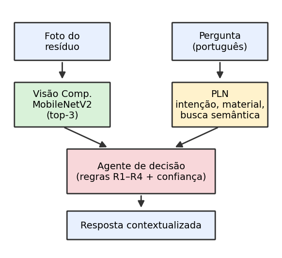

# EcoAssist — assistente de descarte de resíduos (Projeto B)

Projeto final da disciplina de Inteligência Artificial — AFYA | UNIMA Maceió (Prof. Icaro Ferreira).

| | |
|---|---|
| **Integrantes e responsabilidades** | Antonio de Freitas Melo — integração dos módulos e desenvolvimento da interface Streamlit<br>Kauê Anderson Arry Pereira de Andrade — visão computacional, treinamento e avaliação do modelo de classificação de imagens<br>Bruno Duarte Bastos — processamento de linguagem natural, classificação de intenções e busca semântica<br>Luis Arthir Alves Cordeiro — regras de decisão e organização da base de conhecimento sobre descarte<br>Servio Tullio Marinho Machado — testes do sistema, análise dos resultados e documentação do projeto |
| **Artigo (Overleaf, visualização)** | [Ver artigo no Overleaf](https://www.overleaf.com/project/6afdf3598f6c9086531788c5/share#77ae5ace5b6f22a58e21c2c4e2882606ae2fc8eb57fd2810) |
| **Artigo (PDF)** | [Baixar PDF](artigo/Main.pdf) |

## Problema
Dúvidas sobre *como* descartar cada resíduo reduzem a eficiência da coleta seletiva. No EcoAssist, o usuário envia a **foto** de um resíduo e escreve uma **pergunta em português** ("Posso reciclar isso?", "Qual a cor da lixeira?"). O sistema reconhece o material, interpreta a pergunta e responde com a orientação de descarte e a fonte usada.

## Arquitetura


| Módulo | Pasta | Técnica |
|---|---|---|
| Visão Computacional + ML | `src/visao_computacional`, `src/machine_learning` | MobileNetV2 com *transfer learning* no TrashNet (supervisionado); baseline HOG + SVM |
| PLN | `src/pln` | Intenção: TF-IDF + Regressão Logística; extração do material citado; busca semântica (Sentence-Transformers multilíngue, com contingência TF-IDF) |
| Decisão | `src/decisao` | Agente baseado em regras R1–R5 sobre as confianças da imagem e do texto |
| Integração | `src/pipeline.py`, `app.py` | Fluxo único foto + pergunta → resposta, interface Streamlit |

**Regras do agente** (`src/decisao/agente.py`):
- **R1:** confiança visual < 0,60 e nenhum material no texto → pede nova foto.
- **R2:** confiança visual baixa, mas o texto cita um material → usa o material do texto.
- **R3:** texto contradiz uma imagem confiante → a imagem prevalece, com aviso.
- **R4:** caso padrão → usa a predição visual.
- **R5:** confiança da intenção < 0,40 → responde com um resumo (material, reciclável, lixeira, descarte).

## Reproduzir a demonstração
Testado no Windows 11 com Python 3.14 (CPU, sem GPU). Os passos abaixo foram verificados em uma cópia limpa do repositório e um ambiente virtual novo.

```bash
git clone https://github.com/antoniofm2/ecoassist.git ecoassist
cd ecoassist
python -m venv .venv
.venv\Scripts\activate          # Linux/macOS: source .venv/bin/activate
pip install -r requirements.txt
streamlit run app.py
```
Abra http://localhost:8501, envie uma foto e escreva uma pergunta.

**Modelos treinados:**
- **Visão:** `resultados/mobilenetv2_trashnet.pt` já está no repositório (9 MB). Não é preciso baixar o TrashNet nem treinar para rodar o app.
- **Intenção:** é treinada automaticamente na primeira execução, a partir de `dados/intencoes.csv` e `dados/intencoes_extra.csv` (poucos segundos, resultado determinístico).
- **Busca semântica:** o modelo `paraphrase-multilingual-MiniLM-L12-v2` é baixado do Hugging Face na primeira execução (cerca de 460 MB), por isso a primeira abertura demora alguns minutos. No Windows pode aparecer um aviso sobre *symlinks* do cache do Hugging Face, que não afeta o funcionamento. Sem internet, o app usa a contingência TF-IDF automaticamente.

**Testes:**
```bash
pytest testes
```

## Reproduzir o treino e os experimentos
```bash
# 1. TrashNet (https://github.com/garythung/trashnet, arquivo data/dataset-resized.zip)
#    extraído em dados/trashnet/<classe>/*.jpg
python -m src.machine_learning.treinar_imagens --dados dados/trashnet --epocas 6
python -m src.machine_learning.gerar_graficos
# 2. Intenção
python -m src.pln.gerar_intencoes
python -m src.pln.intencao
python -m src.pln.avaliar_intencao_livre
# 3. Ponta a ponta (imagens de teste do TrashNet + perguntas livres)
python -m src.avaliacao_ponta_a_ponta
```
Também há o notebook `notebooks/treino_colab.ipynb` para treinar no Google Colab. Divisões estratificadas com semente 42.

## Resultados
Todos os valores vêm de arquivos em `resultados/`.

**Visão computacional** — TrashNet, 2527 imagens; divisão 70/15/15 (teste = 380); CPU; 6 épocas.

| Modelo | Acurácia | F1 macro |
|---|---|---|
| HOG + SVM | 0,611 | 0,582 |
| MobileNetV2 | 0,882 | 0,865 |

Principais confusões: papelão → papel e vidro → metal. A classe `trash` (rejeito) acerta 12 de 20 imagens.

**PLN e sistema integrado** — 48 perguntas livres (8 por intenção) e 48 pares (imagem de teste do TrashNet + pergunta livre):

| Versão | Intenção (48 perguntas) | Ponta a ponta (48 pares) | Natureza |
|---|---|---|---|
| Inicial (commit `40702b0`) | 0,65 | **54,2%** | Avaliação inicial: conjunto não usado para ajustar nada |
| Ajustada (atual) | 0,90 | **66,7%** | **Resultado de desenvolvimento:** as mesmas 48 perguntas guiaram os ajustes, então é otimista |

- O teste sintético de intenção chega a 0,94, mas compartilha os modelos de frase com o treino.
- Os resultados iniciais ficam preservados em `resultados/inicial/`.
- Os ajustes da versão atual foram: mais 69 frases escritas à mão, regularização C=10, regra R5, busca restrita à classe prevista e embeddings multilíngues.

**Avaliação final:** os pares novos do grupo, com fotos de celular e respostas esperadas definidas antes de usar o app, ficam em `dados/avaliacao_final/`. O passo a passo está em [`dados/avaliacao_final/LEIAME.md`](dados/avaliacao_final/LEIAME.md). Essa avaliação ainda não foi realizada.

## Casos de baixa confiança e perguntas compostas
- **Baixa confiança visual (R1):** acionada em 5 dos 48 pares.
  - Em 3 deles, a classe mais provável estava errada (papelão → vidro 0,29; plástico → vidro 0,29; rejeito → papel 0,33), e o agente pediu nova foto em vez de responder errado.
  - Nos outros 2, a classe estava certa, mas com pouca confiança (metal 0,52; rejeito 0,34).
  - Três erros visuais passaram do limiar e geraram resposta errada (vidro → metal 0,70; rejeito → papel 0,85 e 0,63).
- **Baixa confiança da intenção (R5):** acionada em 12 dos 48 pares da versão ajustada. Neles, a intenção mais provável estava certa em só 33% dos casos, por isso o resumo é mais seguro do que um palpite.
- **Pergunta composta:** o PLN atribui uma única intenção por pergunta. No teste do app, a pergunta "em qual cor de lixeira da coleta seletiva isso entra, e precisa lavar antes?" recebeu resposta só sobre a cor da lixeira, e a parte sobre lavar foi ignorada.

## Limitações
- O TrashNet tem fundo uniforme, então fotos reais tendem a ter desempenho pior. A avaliação com fotos de celular está pendente.
- O dataset de intenções é majoritariamente sintético. As 48 perguntas livres foram escritas com apoio de IA.
- A base de conhecimento é pequena e as regras de coleta variam por município.
- Não há tratamento de vários objetos na mesma imagem nem de perguntas com várias partes.
- A extração do material citado usa palavras-chave. Termos genéricos ("lixo", "garrafa") podem gerar falsos conflitos (R3).

## Estrutura
```
app.py                    interface Streamlit
src/visao_computacional/  classificador MobileNetV2
src/machine_learning/     treino, baseline e gráficos
src/pln/                  intenção, palavras-chave, busca semântica
src/decisao/              agente de regras
src/pipeline.py           fluxo integrado
src/avaliacao_*.py        avaliação ponta a ponta e final
dados/                    base de conhecimento, intenções, perguntas, avaliação final
resultados/               modelos, métricas, gráficos (inicial/ = avaliação inicial)
notebooks/                treino no Colab
testes/                   pytest
artigo/                   LaTeX (IEEE) + figuras + PDF
```

## Referências
Lista completa e verificada em `artigo/main.tex`. As principais são:
- TrashNet (Yang & Thung, 2016).
- MobileNetV2 (Sandler et al., 2018).
- Sentence-BERT (Reimers & Gurevych, 2019).
- Resolução CONAMA nº 275/2001.
